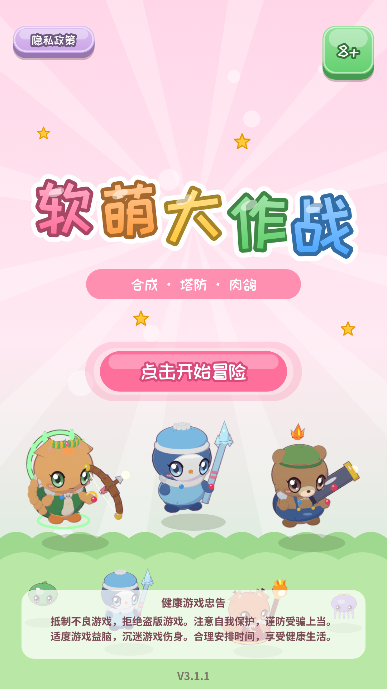
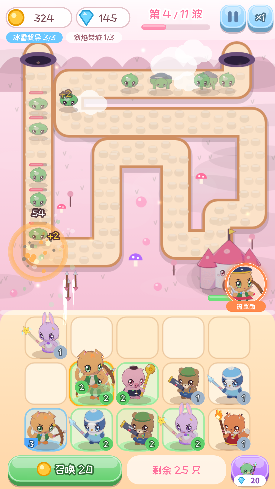
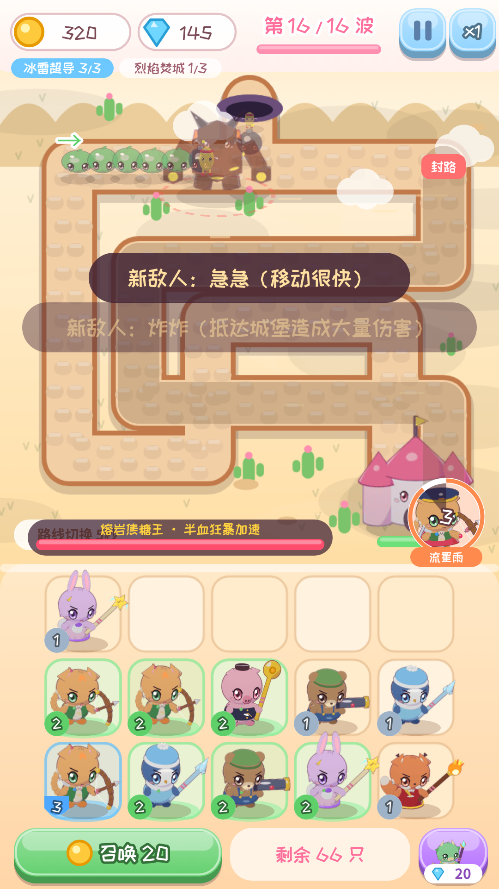

# 软萌大作战

**把萌宠合成、阵容搭配与波次塔防放进一块竖屏战场。**

软萌大作战是一款使用原生 JavaScript 和 Canvas 2D 开发的萌宠合成塔防小游戏。玩家通过召唤、拖拽合成与布阵提升队伍，在不断推进的敌人波次中选择强化方向，挑战章节、首领和无尽模式。

项目包含战斗与局外成长系统、角色美术资源、多平台构建脚本和开发辅助工具。逻辑画布为 360 × 640，工程面向 Web、微信小游戏、抖音小游戏及 App 容器组织适配。

## 游戏画面

<p>
  
  
  
</p>

以上为仓库留存截图；更多战斗、阵容与美术效果见 [shots](shots/) 和 [sheets](sheets/)。

## 怎么玩

1. **召唤与布阵**：使用局内资源召唤萌宠，把不同攻击特点的伙伴安排在战场格位。
2. **拖拽与合成**：在有限格位中合成升级，权衡即时战力和后续成长空间。
3. **搭配与进化**：利用减速、持续伤害、范围攻击等机制组合阵容，选择进化分支，并追求融合与终极形态。
4. **选卡与守城**：应对波次、精英与首领，根据当前队伍选择强化卡牌，守住城堡。
5. **解锁与再挑战**：推进章节、解锁伙伴，带着局外成长尝试不同模式与阵容。

## 内容与系统

### 章节与挑战

章节从棉花糖草原、果冻森林一路延伸到星河彼岸。关卡配置将路线、敌人组合和场景机制分开组织，包含双路线、暴风雪、流沙、迷雾等变化。

除章节推进外，项目还包含无尽、每日挑战、首领车轮战、周活动与远征等模式。远征通过节点地图串联战斗、奇遇、商店、营地与奖励，让战斗之外也有路线选择。

### 阵容与养成

基础萌宠覆盖不同攻击定位：弓箭速射、冰冻减速、毒伤削甲、范围炮击等。等级成长、A/B 进化、融合配方与终极形态构成阵容的纵向发展；英雄主动技能、遗物和强化卡牌则提供横向搭配。

局外包含天赋、图鉴、成就、签到、每日任务、皮肤和离线收益。扭蛋使用游戏内免费获得的扭蛋券，代码中包含概率展示、保底与重复转化规则。

### 美术与反馈

角色资源包含待机、蓄力、攻击和恢复等帧。项目将角色帧、武器发射点、弹道与命中特效配合使用，并通过等级特效和融合演出区分成长阶段。菜单与战斗音乐、音效以及静音设置也纳入同一套游戏反馈。

## 技术实现

- **原生 Canvas 2D 渲染**：游戏主循环、场景、实体和 UI 分层组织，使用逻辑坐标处理竖屏布局。
- **数据驱动的战斗内容**：角色属性、章节、英雄、遗物、分支和卡牌由配置文件组织，方便内容扩展与数值调整。
- **平台能力抽象**：广告、分享、录屏、侧边栏复访和排行榜等能力集中到平台层，游戏场景通过统一入口调用。
- **同一份源码构建多端**：构建脚本按目标平台保留对应代码，输出 Web、微信、抖音和 App 容器资源。
- **图集与分包加载**：角色资源组织为图集，小游戏构建按资源体积分包；启动流程包含下载与解码进度。
- **开发工具与发布内容分离**：截图钩子、数值模拟和自测脚本保留在开发目录，构建时排除开发截图工具。

## 本地体验

需要 Node.js、npm；以下预览方式同时需要 Python。

```sh
npm ci
python -m http.server 4173
```

在浏览器中打开 http://localhost:4173 。根目录的 `index.html` 是开发入口。

### 检查与构建

```sh
npm run lint
npm run format:check
npm run build
```

构建脚本输出 `dist/web`、`dist/wechat`、`dist/douyin` 与 `dist/app`，并调用小游戏检查工具。Web 产物可以通过静态服务器预览；微信与抖音产物分别导入对应开发者工具。`dist/app` 是容器资源，不能直接当作已签名安装包。

开发用截图入口为 `index.html?shot=名称`，可用场景见 [`dev/testShots.js`](dev/testShots.js)。数值模拟和可选服务端的使用方式见 [开发与平台配置](docs/DEVELOPMENT.md)。

## 源码导航

```text
src/
  main.js         游戏入口与主循环
  data/           战斗、章节、角色与成长配置
  core/           战斗规则、存档、局外系统与远征
  entities/       实体与路线相关工具
  scenes/         标题、地图、菜单与战斗场景
  ui/             界面、渲染、音效与特效
  platform/       平台能力与适配配置
assets/           图集、字体与音频
dev/              截图、模拟与开发自测
tools/            多端构建、资源处理与检查工具
server/           可选的扭蛋记录与排行榜服务
```

建议从 `src/main.js` 进入场景和战斗流程，再结合 `src/data/config.js`、`src/data/content.js` 理解内容配置。

## 项目状态与使用说明

仓库保留了可运行工程、截图、开发工具与迭代记录。平台适配代码和构建目标不代表已经通过各平台审核或完成所有设备验收；平台 AppID、广告位和可选服务端地址需要按自己的环境配置。当前配置中的部分 ID 为占位或测试用途，使用前应核对归属。

当前游戏设计不包含真实货币支付入口；广告与奖励的实现和频控说明见 [开发与平台配置](docs/DEVELOPMENT.md)。历史开发记录见 [CHANGELOG](CHANGELOG.md) 与 [PROGRESS](PROGRESS.md)，其中的旧版本参数以当前源码为准。

项目未授予通用开源许可；第三方资源说明见 [third_party_licenses.md](docs/third_party_licenses.md)，隐私说明见 [privacy.md](docs/privacy.md)。
